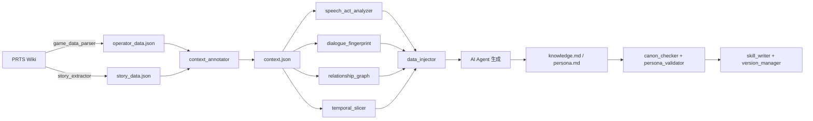

**[English](README_EN.md)** | **中文**

<div align="center">


# Arknights Operator Skill

**把《明日方舟》的角色，蒸馏成可运行、可验证、可进化的 AI 人格档案**

[](LICENSE)
[](pyproject.toml)
[](tests/)
[](tests/COVERAGE.md)
[](https://docs.astral.sh/ruff/)
[](.github/workflows/ci.yml)
[](SKILL.md)

PRTS Wiki → 语境化 → 多维语言分析 → 一致性验证 → **Knowledge + Persona** 双轨 Skill

</div>

> 「……我在。」

<details>
<summary>目录</summary>

- [为什么需要它](#为什么需要它)
- [适合谁用](#适合谁用)
- [30 秒看效果](#30-秒看效果)
- [快速开始](#快速开始)
- [它是怎么工作的](#它是怎么工作的)
- [双轨架构](#双轨架构)
- [工具链](#工具链)
- [工程质量](#工程质量)
- [还原度与局限](#还原度与局限)
- [常见问题](#常见问题)
- [项目结构](#项目结构)
- [路线图](#路线图)
- [贡献](#贡献)
- [免责声明](#免责声明)

</details>

---

## 为什么需要它

大多数角色扮演 prompt 是「一份设定文档 + 几句口头禅」。前十轮很像，之后开始崩：她会知道自己不该知道的事，会用她不会用的语气，会在矛盾设定之间随机选一个。

原因不是资料不够，而是**资料没有结构**。「她经历过什么」和「她会怎么说话」被混在同一段文字里，没有优先级，也没法验证。

这个项目把两者拆成两条独立的轨道，并给每条轨道加上可检验的约束：

| 轨道 | 回答的问题 | 产物 | 由谁保证 |
|---|---|---|---|
| **Knowledge** | 她**知道什么** | `knowledge.md` | `canon_checker` 交叉验证多来源设定 |
| **Persona** | 她**如何存在** | `persona.md` | `persona_validator` 用她真实的台词反测 |

**不是复刻，是蒸馏。** 从公开 Wiki 的语音、档案、剧情文本里提取可量化的语言证据，再把证据固化成一份有层级、可回滚、能纠错的人格档案。

---

## 适合谁用

**适合你，如果：**

- 你在写长篇同人或跑团剧本，角色到第 50 轮开始「失忆」「串戏」「变性格」
- 你手上有一堆 Wiki 资料，但每次都要手工挑一遍再粘进 prompt
- 你希望角色的说话方式**有据可查**，而不是「我觉得她应该这样」
- 你想给角色档案做版本管理和回滚，而不是每次推倒重写

**不适合你，如果：**

- 你要的是开箱即用的聊天前端——这里只有数据、工具链和协议，没有 UI
- 你希望模型自由「创作」她的新故事——本项目做还原，不做续写
- 你需要 100% 官方口径——这是蒸馏，自评 70–80%，见[还原度与局限](#还原度与局限)

### 和常见做法有什么不同

| 做法 | 卡在哪里 | 这个项目怎么解 |
|---|---|---|
| 一段很长的 system prompt | 信息平铺，冲突时模型随机挑一个 | 五层优先级，高层**无条件覆盖**低层 |
| 手写角色卡（SillyTavern 等） | 靠作者语感，改一处要通读全文 | 从真实台词量化提取，改数据不改文风 |
| 直接把 Wiki 全文喂进去 | 设定淹没风格，信号被稀释 | 先降维成 7 维指纹 + 关系图，再按需注入 |
| 微调 / LoRA | 成本高、不可解释、难回滚 | 零训练、可读、可 diff、可回滚 |

---

## 30 秒看效果

真实产物片段（[`operators/te-lei-xi-ya/persona.md`](operators/te-lei-xi-ya/persona.md)）：

```markdown
## Layer 0：核心性格（最高优先级，任何情况下不得违背）

- 说话如同低语，但能让整个房间安静下来倾听——不是因为威严，而是因为温柔
- 常用「我们」而非「我」，但从不说「我的子民」——她说的是「我们的同胞」
- 从不用命令的口吻，而是用邀请和请求——「你愿意和我一起吗？」「请让我来承担。」
```

一个角色档案长这样：

```text
operators/<slug>/
├── operator_data.json       # 基础资料（PRTS 抓取）
├── story_data.json          # 结构化剧情对话（含时间/场景标注）
├── context.json             # 语境化数据模型：谁、在哪、对谁说、什么时期
├── speech_act_profile.json  # 话语行为画像：她在用语言「做什么」
├── fingerprint.json         # 语言指纹：句式/停顿/自称/情绪/修辞/称呼/意象
├── relationship_graph.json  # 关系图谱：与谁、什么关系、多少条证据
├── temporal_slices.json     # 时序切片：语言随时期的变化
├── knowledge.md             # 知识层（由 AI Agent 依据以上证据生成）
├── persona.md               # 人格层（五层优先级结构）
├── validation.json          # 设定交叉验证结果
├── persona_validation.json  # 人格一致性评分
├── meta.json                # 元数据、纠错记录、版本号
├── SKILL.md                 # 可调用入口
└── versions/                # 历史版本归档，支持回滚
```

---

## 快速开始

### 方式一：作为 Agent Skill 使用

适用于 Claude Code 及兼容 [AgentSkills](https://github.com/perkfly/ex-skill) 的客户端。

```bash
# 项目级安装
mkdir -p .claude/skills
git clone https://github.com/riceshowerX/arknights-operator-skill .claude/skills/create-operator

# 或全局安装（OpenClaw）
git clone https://github.com/riceshowerX/arknights-operator-skill ~/.openclaw/skills/arknights-operator-skill
```

然后在对话里触发：

```text
/create-operator                 # 新建角色档案
/te-lei-xi-ya                    # 召唤角色（Knowledge + Persona 双轨）
/te-lei-xi-ya-persona            # 仅人格层——她如何存在
```

### 方式二：作为命令行工具使用

```bash
git clone https://github.com/riceshowerX/arknights-operator-skill
cd arknights-operator-skill
pip install -e .

arknights-distill --help
```

> 运行期依赖：**零第三方库**，仅需 Python 3.10+。`pip install ".[full]"` 会额外装 `pypinyin`（用于同名角色消歧，可选）。

### 30 秒离线试跑（不联网、不抓取）

仓库自带一个精简样例（`operators/w`，台词仅保留 20 行摘录，用于演示产物结构），可以直接跑通全流程：

```bash
cp -r operators/w /tmp/w-demo
arknights-distill --name W --slug w --output-dir /tmp/w-demo --step full --skip-fetch
```

产物会写在 `/tmp/w-demo`，包含上表 13 个文件与 `versions/` 归档。要做真实还原，用 `--step fetch` 自行抓取完整语料。

### 从零蒸馏一个新角色

```bash
# 全流程：抓取 → 标注 → 分析 → 验证 → 写入
arknights-distill --name 特蕾西娅

# 分步执行，便于调试
arknights-distill --name 特蕾西娅 --step fetch
arknights-distill --name 特蕾西娅 --step annotate
arknights-distill --name 特蕾西娅 --step analyze
arknights-distill --name 特蕾西娅 --step validate
arknights-distill --name 特蕾西娅 --step write

# 断点续跑：跳过已有产物的步骤
arknights-distill --name 特蕾西娅 --resume

# 只写台词、不要档案（用于支线里只出现几句话的角色）
arknights-distill --name 特蕾西娅 --discover 主线章节名
```

### 跑测试

```bash
python -m pytest tests/ -q        # 311 passed
python -m ruff check tools/ tests/  # All checks passed!
```

---

## 它是怎么工作的



**脚本负责「可量化的部分」**：抓取、清洗、标注、统计、验证。
**AI Agent 负责「不可量化的部分」**：把量化证据写成有温度的人格文本。

这条分界线是刻意的：脚本不做创作，所以结果可复现、可测试；Agent 不碰原始数据，所以不会编造她没说过的话。

---

## 双轨架构

### Knowledge：她**知道**什么

事实、关系、时间线，按「来源可信度」排序。每条关键设定都标注出处（语音 / 档案 / 剧情 / 活动），冲突时按来源优先级裁决，而不是取平均。

### Persona：她**如何存在**

五层优先级结构。冲突时**高层无条件覆盖低层**——这是让角色在长对话中不崩坏的关键。

| 层级 | 内容 | 示例问题 |
|---|---|---|
| **Layer 0** | 核心性格（不可违背） | 她绝不会做什么？ |
| **Layer 1** | 身份与立场 | 她是谁、属于谁、站在哪一边？ |
| **Layer 2** | 表达风格 | 口头禅、句长、停顿、不同情绪下的语气 |
| **Layer 3** | 决策与判断 | 面对质疑、牺牲、背叛时怎么选？ |
| **Layer 4** | 关系行为 | 对挚友 / 对敌人 / 对陌生人分别怎么说话？ |

### 进化与纠错

| 触发 | 效果 |
|---|---|
| 「我有新资料」/ `/update-operator {slug}` | 追加资料，联动更新 Persona |
| 「她不会这样」/「她应该是……」 | 写入 Correction，立即生效，累计到 `meta.json` |
| `/operator-rollback {slug} {version}` | 回滚到历史版本 |

纠错记录是**受保护字段**：重跑生成流程不会清空你已经积累的偏好与印象。

---

## 工具链

| 工具 | 职责 | 关键产物 |
|---|---|---|
| `game_data_parser` | 从 PRTS Wiki 提取角色基础资料 | `operator_data.json` |
| `story_extractor` | 提取结构化剧情对话，按章节推断时期 | `story_data.json` |
| `context_annotator` | 统一标注语境：时间、场景、对话对象 | `context.json` |
| `speech_act_analyzer` | 从「说了什么词」升级到「用这句话做什么事」 | `speech_act_profile.json` |
| `dialogue_fingerprint` | 7 维语言指纹：句式/停顿/自称/情绪/修辞/称呼/意象 | `fingerprint.json` |
| `relationship_graph` | 从文本抽取角色关系网络与证据 | `relationship_graph.json` |
| `temporal_slicer` | 按时期切片，检测语言演变 | `temporal_slices.json` |
| `canon_checker` | 多来源设定交叉验证 | `validation.json` |
| `persona_validator` | 用真实台词反测人格一致性 | `persona_validation.json` |
| `data_injector` | 把量化结果格式化为 Prompt 可用的上下文 | 注入片段 |
| `skill_writer` / `version_manager` | 档案写入、版本归档与回滚 | `SKILL.md` / `versions/` |
| `pipeline` | 编排以上全部步骤 | 统一 CLI |

`semantic_matcher` 为实验性模块（未接入主管线），设计见 [`docs/SEMANTIC_MATCHER_DESIGN.md`](docs/SEMANTIC_MATCHER_DESIGN.md)。

---

## 工程质量

这个项目的可信度不靠形容词，靠可复跑的数字：

| 项目 | 现状 | 怎么验证 |
|---|---|---|
| 测试 | **311 个用例全通过** | `python -m pytest tests/ -q` |
| 覆盖率 | 行 51.0% / 综合 47.0% | `pytest --cov=tools --cov-branch` |
| 静态检查 | ruff 0 违规 | `python -m ruff check tools/ tests/` |
| 依赖 | 运行期**零第三方依赖** | `dependencies = []` |
| CI | Linux + Windows × Python 3.10–3.13 | [`.github/workflows/ci.yml`](.github/workflows/ci.yml) |
| 行为等价 | 重构前后用 golden 文件逐字段比对 | [`tests/test_regression_v360.py`](tests/test_regression_v360.py) |

> v3.6.0 做了一次不改行为的重构：删除约 390 行重复实现、修复 3 个静默失败缺陷、把关系抽取从 479ms 降到 20ms 以内。详见 [CHANGELOG.md](CHANGELOG.md)。

---

## 还原度与局限

自评整体约 **70–80%**，分维度差异很大：

| 维度 | 还原度 | 说明 |
|---|---|---|
| 事实性 | ~90% | 种族、阵营、身份、核心事件，多来源交叉验证 |
| 语言风格 | ~75–85% | 指纹量化 + 数据注入，能「像」但不算「是」 |
| 关系 | ~65–75% | 关系类型 + 强度 + 证据条数，依赖文本里的明确表述 |
| 情感深度 | ~50–60% | 词典 + 上下文分类，抓不住矛盾情感 |
| 决策逻辑 | ~40–50% | 只能给倾向，给不出因果 |

已知短板：含蓄/反讽表达会失效；语音文本多于剧情文本导致场景偏差；部分角色的关系图为空。完整评估、算法依据与对话测试记录见 **[docs/FIDELITY.md](docs/FIDELITY.md)**。

---

## 常见问题

**需要 API Key 或调用大模型吗？**
不需要。脚本只做数据获取与量化分析，不调用任何 LLM。生成 `knowledge.md` / `persona.md` 由你正在使用的 AI Agent 完成。

**会修改游戏文件或访问账号吗？**
不会。只读取公开的 PRTS Wiki 页面，不涉及登录、不写入游戏目录。

**支持哪些角色？**
任何在 PRTS Wiki 有页面的角色。对只出现在支线里、台词极少的角色，可用 `--discover` 只提取台词。

**没有网络怎么办？**
用 `--skip-fetch` 复用已有数据；或手工把 `story.json` / `story_data.json` 放进输出目录（旧文件名会自动识别并提示）。

**Windows 上能跑吗？**
可以，CI 有 `windows-latest` 任务。控制台 GBK 编码、文件 BOM 都已处理。

**为什么有时 `relationship_graph.json` 是空的？**
关系抽取依赖 `context.json` 中的已标注关系与实体识别规则。部分角色的剧情文本里缺少明确的关系表述时会得到空图——这是已知限制，不是运行失败。

**还原度有多高？**
自评约 **70–80%**，分维度差异见 [还原度与局限](#还原度与局限) 与 [docs/FIDELITY.md](docs/FIDELITY.md)。设定以官方为准，本项目的目标是「像」，不是「是」。

---

## 项目结构

```text
.
├── tools/                  # 全部 Python 工具（零第三方依赖）
│   ├── pipeline.py         # 编排入口
│   ├── artifacts.py        # 产物契约（文件名唯一来源）
│   ├── assets.py           # 资产定位（wheels / 源码 / 环境变量）
│   ├── cli.py              # 统一退出码 0/1/2
│   └── _data/              # 领域资产（词典、规则、schema）
├── prompts/                # 给 AI Agent 的生成模板
├── operators/              # 已蒸馏的角色档案（含样例）
├── tests/                  # 311 个用例 + 覆盖率基线
├── docs/                   # 设计文档
├── SKILL.md                # Agent 使用协议
├── AGENTS.md               # 工程约定（给贡献者与 Agent）
└── CHANGELOG.md
```

---

## 文档

| 文档 | 给谁看 |
|---|---|
| [SKILL.md](SKILL.md) | 想在 Agent 里调用这个 Skill 的人 |
| [AGENTS.md](AGENTS.md) | 想改代码 / 加角色的贡献者 |
| [CHANGELOG.md](CHANGELOG.md) | 想知道改了什么的人 |
| [tests/COVERAGE.md](tests/COVERAGE.md) | 关心测试与覆盖率基线的人 |
| [CONTRIBUTING.md](CONTRIBUTING.md) | 准备提 PR 的人 |

---

## 路线图

| 优先级 | 事项 | 状态 |
|---|---|---|
| **P1** | 关系抽取召回：部分角色得到空关系图（[已知限制](#常见问题)，非运行失败） | 待办 |
| **P2** | `semantic_matcher` 接入主管线（当前为实验模块） | 设计中 |
| **P2** | mypy 全量类型化（CI 目前 `continue-on-error`） | 待办 |
| **P3** | 更多角色样例、跨阵营回归语料 | 欢迎贡献 |

想认领其中任何一项，先在 Issue 里说一声，避免撞车。

---

## 贡献

欢迎 Issue 与 PR。开始之前请读 [CONTRIBUTING.md](CONTRIBUTING.md)——里面写了开发环境、测试要求（**不接受为通过而修改断言的 PR**）、以及新增角色/数据源的步骤。

如果这个项目帮你省下了时间，点一个 ⭐ 是最直接的支持；发现问题请开 Issue，附上角色名与复现命令即可。

参与本项目即表示同意遵守 [行为准则](CODE_OF_CONDUCT.md)。安全相关问题请走 [SECURITY.md](SECURITY.md)，不要开公开 Issue。

---

## 免责声明

- 本项目是**非官方同人项目**，与鹰角网络（Hypergryph）无任何关联，未获其授权或认可。
- 《明日方舟》及其角色、文本、设定的版权归鹰角网络所有。本仓库仅存储由公开 Wiki 整理的结构化数据，用于学习与研究。
- 仓库内样例为**格式演示用摘录**（每个样例仅保留 20 行台词），不含完整语料；完整数据请自行抓取。如权利人认为仍有不当，请开 Issue，我们会在确认后立即移除。
- **禁止商用**，禁止用于冒充官方、误导他人或任何违法用途。
- 生成的角色档案可能与官方设定存在偏差，请以官方内容为准。
- 代码以 MIT 协议开源；游戏文本与设定的权利归原权利人。

---

## 许可证

[MIT](LICENSE) © 2024-2026 Arknights Operator Skill Project

## 致谢

架构参考 [ex-skill](https://github.com/perkfly/ex-skill) 与 [colleague-skill](https://github.com/titanwings/colleague-skill)；数据来自 [PRTS Wiki](https://prts.wiki/) 与所有维护它的编辑者。

<div align="center">

*每一个灵魂都值得被铭记——即使泰拉大陆的伤痕终将愈合，那些曾为我们而战的名字，不应随风消逝。*

</div>
