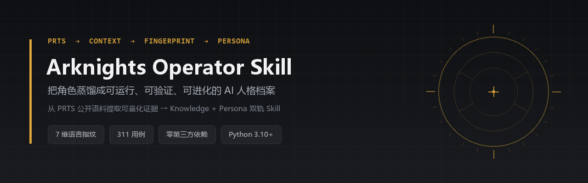
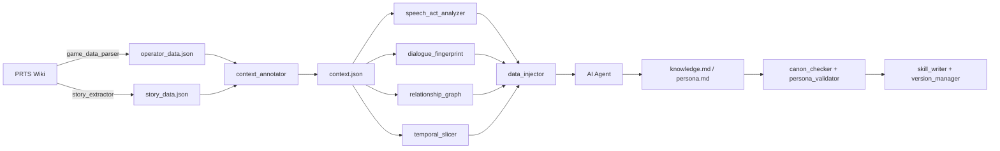

**English** | **[中文](README.md)**

<div align="center">



# Arknights Operator Skill

**Distill Arknights operators into runnable, verifiable, evolvable AI persona archives**

[](LICENSE)
[](pyproject.toml)
[](tests/)
[](tests/COVERAGE.md)
[](https://docs.astral.sh/ruff/)
[](.github/workflows/ci.yml)
[](SKILL.md)

PRTS Wiki → contextualization → multi-dimensional language analysis → validation → **Knowledge + Persona** skill

</div>

> "…I'm here."

<details>
<summary>Contents</summary>

- [Why this exists](#why-this-exists)
- [Who it's for](#who-its-for)
- [What you get in 30 seconds](#what-you-get-in-30-seconds)
- [Quick start](#quick-start)
- [How it works](#how-it-works)
- [Two tracks](#two-tracks)
- [Toolchain](#toolchain)
- [Engineering quality](#engineering-quality)
- [Fidelity and limits](#fidelity-and-limits)
- [FAQ](#faq)
- [Project layout](#project-layout)
- [Roadmap](#roadmap)
- [Contributing](#contributing)
- [Disclaimer](#disclaimer)

</details>

---

## Why this exists

Most roleplay prompts are "one lore dump plus a few catchphrases". The first ten turns feel right, then the character collapses: she knows things she shouldn't, speaks in cadences she never used, and picks randomly between contradictory settings.

The problem isn't a lack of material — it's the **lack of structure**. "What she has lived through" and "how she speaks" are blended into a single blob of prose with no priorities and nothing to verify against.

This project splits them into two independent tracks, each with checkable constraints:

| Track | Question it answers | Artifact | Enforced by |
|---|---|---|---|
| **Knowledge** | What does she **know**? | `knowledge.md` | `canon_checker` cross-validates sources |
| **Persona** | How does she **exist**? | `persona.md` | `persona_validator` tests it against her real lines |

**Not a replica — a distillation.** Quantifiable language evidence is extracted from public wiki voices, archives, and story text, then frozen into a layered, rollback-able, correctable persona archive.

---

## Who it's for

**It's for you if:**

- You write long-form fan fiction or run tabletop campaigns, and the character starts "forgetting", "leaking", or "changing personality" around turn 50
- You already have a pile of wiki material but hand-pick and paste it into the prompt every single time
- You want her speech patterns to be **traceable to evidence**, not "I feel like she'd say it this way"
- You want versioning and rollback for persona archives instead of rewriting from scratch

**It's not for you if:**

- You want a ready-to-chat front end — this repo ships data, a toolchain, and a protocol, no UI
- You want the model to freely invent new stories for her — this project restores, it doesn't continue
- You need 100% official canon — it's a distillation, self-rated 70–80%, see [Fidelity and limits](#fidelity-and-limits)

### How it compares

| Approach | Where it breaks | What this project does instead |
|---|---|---|
| One long system prompt | Everything flattened; on conflict the model picks at random | Five priority layers; higher layers **override** lower ones |
| Hand-written character card (SillyTavern etc.) | Depends on the author's ear; one edit means re-reading everything | Quantified from real lines; change the data, not the prose style |
| Dumping the whole wiki in | Lore drowns the style signal | Reduced to a 7-dimension fingerprint + relationship graph, injected on demand |
| Fine-tuning / LoRA | Expensive, opaque, hard to roll back | No training, readable, diffable, rollback-able |

---

## What you get in 30 seconds

A real excerpt ([`operators/te-lei-xi-ya/persona.md`](operators/te-lei-xi-ya/persona.md), Chinese):

```markdown
## Layer 0: Core Personality (highest priority, never violated)

- Speaks like a whisper, yet the whole room falls silent to listen —
  not out of authority, but out of gentleness
- Says "we", never "my subjects" — she says "our people"
- Never gives orders; always invites — "Will you come with me?"
```

An operator archive looks like this:

```text
operators/<slug>/
├── operator_data.json       # Profile scraped from PRTS
├── story_data.json          # Structured story dialogue (time/scene tagged)
├── context.json             # Context model: who, where, to whom, which era
├── speech_act_profile.json  # What she *does* with language
├── fingerprint.json         # 7-dimension language fingerprint
├── relationship_graph.json  # Relations with strength and evidence count
├── temporal_slices.json     # How her language shifts across eras
├── knowledge.md             # Knowledge track (generated by your AI agent)
├── persona.md               # Persona track (5-layer priority structure)
├── validation.json          # Cross-source canon check
├── persona_validation.json  # Persona consistency score
├── meta.json                # Metadata, corrections, version
├── SKILL.md                 # Callable entry point
└── versions/                # Archived versions, supports rollback
```

---

## Quick start

### Option 1 — As an Agent Skill

Works with Claude Code and any client compatible with [AgentSkills](https://github.com/perkfly/ex-skill).

```bash
# Project-level
mkdir -p .claude/skills
git clone https://github.com/riceshowerX/arknights-operator-skill .claude/skills/create-operator

# Global (OpenClaw)
git clone https://github.com/riceshowerX/arknights-operator-skill ~/.openclaw/skills/arknights-operator-skill
```

Then, in a conversation:

```text
/create-operator                 # create a new operator archive
/te-lei-xi-ya                    # summon (both tracks)
/te-lei-xi-ya-persona            # persona track only
```

### Option 2 — As a CLI

```bash
git clone https://github.com/riceshowerX/arknights-operator-skill
cd arknights-operator-skill
pip install -e .

arknights-distill --help
```

> Runtime dependencies: **none beyond the Python 3.10+ standard library**. `pip install ".[full]"` additionally pulls `pypinyin` (optional, used for name disambiguation).

### 30-second offline demo (no network, no scraping)

The repo ships a trimmed sample (`operators/w`, 20 dialogue lines only — it demonstrates the artifact shape, not full fidelity):

```bash
cp -r operators/w /tmp/w-demo
arknights-distill --name W --slug w --output-dir /tmp/w-demo --step full --skip-fetch
```

The output directory will contain all 13 artifacts listed above plus a `versions/` archive. For a real distillation, run `--step fetch` to pull the full corpus yourself.

### Distill a new operator

```bash
# Full pipeline: fetch → annotate → analyze → validate → write
arknights-distill --name 特蕾西娅

# Step by step
arknights-distill --name 特蕾西娅 --step fetch
arknights-distill --name 特蕾西娅 --step annotate
arknights-distill --name 特蕾西娅 --step analyze
arknights-distill --name 特蕾西娅 --step validate
arknights-distill --name 特蕾西娅 --step write

# Resume: skip steps whose artifacts already exist
arknights-distill --name 特蕾西娅 --resume

# Dialogue only, no full archive (for minor characters with a few lines)
arknights-distill --name 特蕾西娅 --discover <chapter-name>
```

### Run the tests

```bash
python -m pytest tests/ -q          # 311 passed
python -m ruff check tools/ tests/  # All checks passed!
```

---

## How it works



**Scripts own the quantifiable part**: fetching, cleaning, tagging, statistics, validation.
**The AI agent owns the unquantifiable part**: turning measurements into prose with a pulse.

The boundary is deliberate. Scripts never write prose, so results are reproducible and testable. The agent never touches raw data, so it cannot invent lines she never said.

---

## Two tracks

### Knowledge — what she **knows**

Facts, relations, timeline, ordered by source reliability. Every key setting cites its origin (voice / archive / story / event). Conflicts are resolved by source priority, not by averaging.

### Persona — how she **exists**

Five layers with strict precedence. On conflict, a higher layer **unconditionally overrides** a lower one — this is what keeps a character intact across long conversations.

| Layer | Content | Example question |
|---|---|---|
| **Layer 0** | Core personality (inviolable) | What would she never do? |
| **Layer 1** | Identity and allegiance | Who is she, who does she stand with? |
| **Layer 2** | Expression style | Catchphrases, sentence length, pauses, tone by mood |
| **Layer 3** | Judgment and decisions | How does she choose under doubt, sacrifice, betrayal? |
| **Layer 4** | Relational behavior | How does she speak to a friend, an enemy, a stranger? |

### Evolution and correction

| Trigger | Effect |
|---|---|
| "I have new material" / `/update-operator {slug}` | Append material, update Persona in tandem |
| "She wouldn't say that" | Write a Correction, effective immediately, counted in `meta.json` |
| `/operator-rollback {slug} {version}` | Restore an archived version |

Corrections are a **protected field**: re-running generation will not wipe the preferences you have accumulated.

---

## Toolchain

| Tool | Responsibility | Key artifact |
|---|---|---|
| `game_data_parser` | Scrape operator profile from PRTS | `operator_data.json` |
| `story_extractor` | Extract structured dialogue, infer era | `story_data.json` |
| `context_annotator` | Tag context: time, scene, interlocutor | `context.json` |
| `speech_act_analyzer` | From "which words" to "what act" | `speech_act_profile.json` |
| `dialogue_fingerprint` | 7-dimension fingerprint | `fingerprint.json` |
| `relationship_graph` | Extract relation network with evidence | `relationship_graph.json` |
| `temporal_slicer` | Slice by era, detect drift | `temporal_slices.json` |
| `canon_checker` | Cross-source canon validation | `validation.json` |
| `persona_validator` | Test persona against real lines | `persona_validation.json` |
| `data_injector` | Format measurements into prompt context | injected fragments |
| `skill_writer` / `version_manager` | Write, archive, roll back | `SKILL.md` / `versions/` |
| `pipeline` | Orchestrate everything | unified CLI |

`semantic_matcher` is experimental and not wired into the main pipeline — see [`docs/SEMANTIC_MATCHER_DESIGN.md`](docs/SEMANTIC_MATCHER_DESIGN.md).

---

## Engineering quality

Credibility here comes from reproducible numbers, not adjectives:

| Item | Status | How to check |
|---|---|---|
| Tests | **311 passing** | `python -m pytest tests/ -q` |
| Coverage | 51.0% line / 47.0% combined | `pytest --cov=tools --cov-branch` |
| Lint | ruff, 0 violations | `python -m ruff check tools/ tests/` |
| Dependencies | **zero runtime third-party deps** | `dependencies = []` |
| CI | Linux + Windows × Python 3.10–3.13 | [`.github/workflows/ci.yml`](.github/workflows/ci.yml) |
| Behavior equivalence | Golden-file diffs before/after refactor | [`tests/test_regression_v360.py`](tests/test_regression_v360.py) |

> v3.6.0 was a behavior-preserving refactor: ~390 lines of duplicated logic removed, 3 silent-failure bugs fixed, relationship extraction from 479 ms to under 20 ms. See [CHANGELOG.md](CHANGELOG.md).

---

## Fidelity and limits

Self-assessed overall: **70–80%**, with large variance by dimension.

| Dimension | Fidelity | Note |
|---|---|---|
| Facts | ~90% | Race, faction, identity, key events, cross-validated |
| Language style | ~75–85% | Measured and injected — "alike", not "identical" |
| Relations | ~65–75% | Depends on explicit statements in the text |
| Emotional depth | ~50–60% | Lexicon + context; contradictory emotions escape it |
| Decision logic | ~40–50% | Tendencies only, no causal model |

Known gaps: irony and implicature break keyword matching; voice text outnumbers story text, skewing scenes; some characters yield an empty relation graph. Full assessment and dialogue transcripts: **[docs/FIDELITY.md](docs/FIDELITY.md)**.

---

## FAQ

**Does it need an API key or call an LLM?**
No. The scripts only fetch and measure. Generating `knowledge.md` / `persona.md` is done by whatever AI agent you use.

**Does it modify game files or touch my account?**
No. It only reads public PRTS Wiki pages.

**Which characters are supported?**
Any character with a PRTS page. For minor characters with very few lines, use `--discover` to extract dialogue only.

**What if I have no network?**
Use `--skip-fetch` to reuse existing data, or place `story.json` / `story_data.json` in the output directory (the legacy filename is detected and reported).

**Does it run on Windows?**
Yes — CI includes `windows-latest`. GBK console encoding and file BOMs are handled.

**Why is `relationship_graph.json` sometimes empty?**
Extraction depends on explicitly stated relations in `context.json`. When the story text lacks them, you get an empty graph. This is a known capability gap, not a runtime failure.

---

## Project layout

```text
.
├── tools/                  # All Python tools (zero third-party deps)
│   ├── pipeline.py         # Orchestration entry
│   ├── artifacts.py        # Artifact contract (single source of names)
│   ├── assets.py           # Asset resolution (wheel / source / env var)
│   ├── cli.py              # Unified exit codes 0/1/2
│   └── _data/              # Domain assets (lexicons, rules, schemas)
├── prompts/                # Generation templates for AI agents
├── operators/              # Distilled archives (samples included)
├── tests/                  # 311 tests + coverage baseline
├── docs/                   # Design and fidelity docs
├── SKILL.md                # Agent usage protocol
├── AGENTS.md               # Engineering conventions for contributors
└── CHANGELOG.md
```

---

## Documentation

| Document | Audience |
|---|---|
| [SKILL.md](SKILL.md) | Anyone invoking this skill from an agent |
| [AGENTS.md](AGENTS.md) | Contributors changing code or adding operators |
| [CHANGELOG.md](CHANGELOG.md) | Anyone tracking what changed |
| [tests/COVERAGE.md](tests/COVERAGE.md) | Anyone checking the test baseline |
| [CONTRIBUTING.md](CONTRIBUTING.md) | Anyone opening a PR |

---

## Roadmap

| Priority | Item | Status |
|---|---|---|
| **P1** | Relationship recall: some operators yield an empty graph (see [FAQ](#faq), not a crash) | Open |
| **P2** | Wire `semantic_matcher` into the main pipeline (currently experimental) | Designing |
| **P2** | Full mypy typing (CI is `continue-on-error` today) | Open |
| **P3** | More operator samples, cross-faction regression corpora | Contributions welcome |

If you want to take any of these on, say so in an issue first so we don't collide.

---

## Contributing

Issues and PRs are welcome. Please read [CONTRIBUTING.md](CONTRIBUTING.md) first — it covers the dev setup, test requirements (**PRs that weaken assertions to go green will be rejected**), and how to add an operator or a data source.

If this project saved you time, a ⭐ is the most direct way to help; for bugs, open an issue with the operator name and the exact command that reproduces it.

By participating you agree to follow the [Code of Conduct](CODE_OF_CONDUCT.md). For security issues, use [SECURITY.md](SECURITY.md) instead of a public issue.

---

## Disclaimer

- This is an **unofficial fan project**, not affiliated with, endorsed by, or authorized by Hypergryph.
- All Arknights characters, text, and settings are the property of Hypergryph. This repository only stores structured data compiled from public wikis, for study and research.
- Samples in this repo are **abridged excerpts for format demonstration** (20 dialogue lines each), not the full corpus; fetch the data yourself for a complete distillation. If a rights holder objects to anything here, open an issue and we will remove it promptly.
- **Non-commercial use only.** Do not use it to impersonate official sources, mislead others, or for any unlawful purpose.
- Generated archives may deviate from official canon; official material always takes precedence.
- Code is MIT licensed; game text and settings remain with their rights holders.

---

## License

[MIT](LICENSE) © 2024-2026 Arknights Operator Skill Project

## Acknowledgements

Architecture inspired by [ex-skill](https://github.com/perkfly/ex-skill) and [colleague-skill](https://github.com/titanwings/colleague-skill). Data from [PRTS Wiki](https://prts.wiki/) and everyone who maintains it.

<div align="center">

*Every soul deserves to be remembered — even after the scars of Terra heal, the names that fought for us should not fade with the wind.*

</div>
